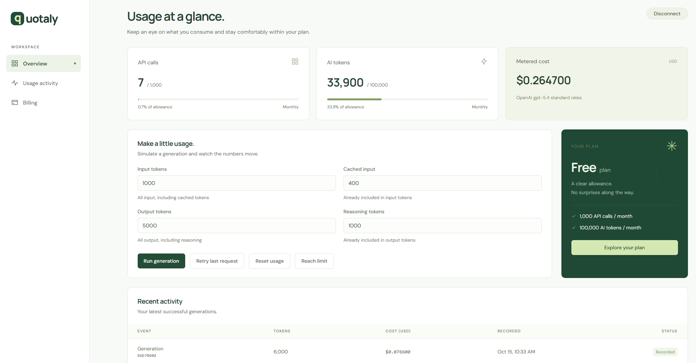

# Quotaly

Quotaly brings AI usage, token costs, and plan limits into one workspace. See how much you consume, understand the cost of each generation, and know how much room remains in your monthly allowance.

Explore the experience with simulated generations in a temporary workspace. No account or personal API key is required.

## Make every unit count

### Understand token costs

Enter input and output token counts, including cached input and reasoning tokens, to simulate a generation. Quotaly calculates its cost using the model rates configured in the workspace and adds the result to your usage history.

Cached input is part of the input total, and reasoning is part of the output total. These details help you explore cost without counting the same tokens twice.

### See limits in action

Track API calls and tokens against separate monthly allowances. A new generation that would exceed either allowance is blocked before it adds usage or cost.

Use **Reach token limit** to fill the remaining token allowance and see what happens at the boundary. **Reset usage** clears your demo usage and activity so you can try another scenario.

### Retry with confidence

Select **Retry last request** to repeat the previous generation. Quotaly returns the original result without adding another API call, token total, or metered cost.

## Choose your allowance

Monthly usage resets on the first day of each month in UTC. Plan changes preserve usage already recorded in the current month.

When billing is configured, **Upgrade to Pro** opens Stripe test Checkout. The app provides test card details, and the subscription price is shown in Checkout.

## License

This project is licensed under the [MIT](LICENSE) License.
